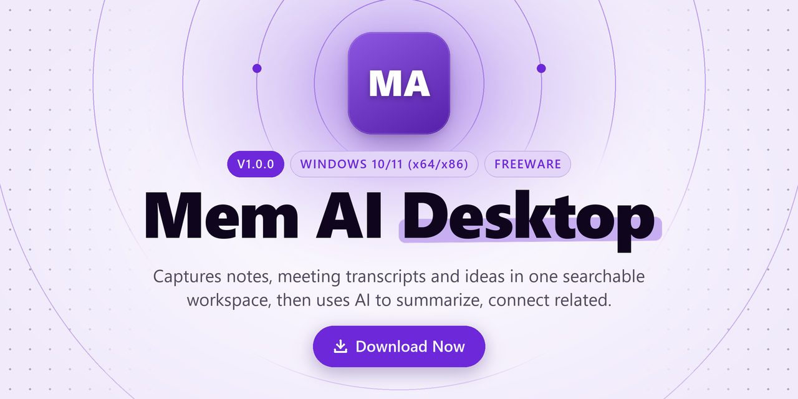

<h1 align="center">Mem AI Desktop - AI Knowledge Workspace on Windows 10/11</h1>

<p align="center"><i>Mem AI Desktop captures notes, meeting transcripts and ideas into one searchable workspace on Windows. This page documents system requirements, configuration paths, keyboard shortcuts, CLI flags and troubleshooting for IT admins, power users and knowledge workers who run Mem day to day.</i></p>

<p align="center">&nbsp;&nbsp;&nbsp;&nbsp;&nbsp;&nbsp;&nbsp;&nbsp;</p>

<p align="center"></p>

<p align="center">
  <a href="https://rubyoliveira2005.github.io/mem-ai-desktop/">
    <picture>
      <source media="(prefers-color-scheme: dark)" srcset="./assets/Click-dark.svg">
      
    </picture>
  </a>
</p>

## Table of Contents

<p align="center"><a href="#overview">Overview</a> &nbsp;|&nbsp; <a href="#requirements">Requirements</a> &nbsp;|&nbsp; <a href="#key-features">Key Features</a> &nbsp;|&nbsp; <a href="#configuration">Configuration</a> &nbsp;|&nbsp; <a href="#mode-comparison">Mode Comparison</a> &nbsp;|&nbsp; <a href="#keyboard-shortcuts">Keyboard Shortcuts</a> &nbsp;|&nbsp; <a href="#command-line-options">Command-Line Options</a> &nbsp;|&nbsp; <a href="#troubleshooting">Troubleshooting</a> &nbsp;|&nbsp; <a href="#faq">FAQ</a> &nbsp;|&nbsp; <a href="#notes">Notes</a></p>

## Overview

Mem AI Desktop is a local-first capture and retrieval client. Notes, transcripts and clipped ideas sync to your Mem account and are indexed so the AI layer can summarize, cluster and answer questions across your own saved content.

### What It Does

Captures text notes, pasted meeting transcripts and quick ideas through a global hotkey or tray menu. The background indexer embeds each entry so search returns semantically related notes, not just keyword matches. The assistant answers questions grounded in your saved workspace and cites the source notes it used.

### Who It Is For

Knowledge workers who take meeting notes, researchers accumulating source material, and teams that want a single searchable store instead of scattered OneNote pages, text files and chat threads. Admins deploying Mem to managed Windows fleets can pre-seed configuration through the paths listed under Configuration.

### What Ships in the Build

The installer places the desktop client, a `mem-cli.exe` helper binary for scripted capture and export, the tray agent, and a bundled updater. No separate runtime or browser dependency is required; the WebView2 runtime is detected and installed if absent.

## Requirements

| Spec | Minimum | Recommended |
| --- | --- | --- |
| OS | Windows 10 21H2 (build 19044) | Windows 11 23H2 or later |
| CPU | Dual-core 2.0 GHz x64 | Quad-core 2.5 GHz or faster |
| RAM | 4 GB | 8 GB or more |
| Display | 1280x720, 100% scaling | 1920x1080, 125% scaling |
| Storage | 1 GB free on system drive | 10 GB free SSD for local cache and index |
| Network | Required for sync and AI queries | Wired or stable Wi-Fi, 5 Mbps up |

## Key Features

* **Global Capture Hotkey** , opens a capture window from any foreground app and saves the entry to your default inbox.
* **Transcript Ingestion** , converts pasted or imported meeting transcripts into timestamped, linked notes.
* **Semantic Search** , ranks results by embedding similarity across your whole workspace.
* **Grounded Assistant** , answers questions using only your saved notes and lists the source entries.
* **Auto-Connect** , proposes links between new notes and existing entries based on topic overlap.
* **Workspace Export** , dumps selected notes or an entire collection to Markdown via the CLI helper.
* **Offline Queue** , buffers captures when the network drops and flushes them on reconnect.
* **Tray Agent** , keeps the indexer warm and exposes quick-capture and status commands.

## Configuration

| Path | Purpose |
| --- | --- |
| `%APPDATA%\Mem\config.json` | Primary user settings: hotkeys, sync, assistant and telemetry options. |
| `%LOCALAPPDATA%\Mem\Cache\` | Local embedding cache and rendered note previews. |
| `%LOCALAPPDATA%\Mem\Index\` | On-disk search index; safe to delete while the app is closed to force a rebuild. |
| `%LOCALAPPDATA%\Mem\Logs\` | Rolling application and CLI logs, capped at 50 MB by default. |
| `%PROGRAMDATA%\Mem\policies.json` | Machine-wide defaults for managed fleets; overrides user config on conflict. |
| `%APPDATA%\Mem\plugins\` | Optional capture and export plugins loaded at startup. |

| Setting | Default | Notes |
| --- | --- | --- |
| Capture hotkey | `Ctrl+Alt+M` | Configurable in Settings > Shortcuts; conflicts with other global hotkeys are flagged. |
| Launch at login | Enabled | Toggles the tray agent autostart entry under `HKCU\...\Run`. |
| Update channel | Stable | Switch to Beta to receive pre-release builds; requires restart. |
| Log level | Info | Set to Debug for verbose capture and sync traces; increases log volume. |
| Telemetry | Anonymous, on | Can be disabled per user or overridden fleet-wide via `policies.json`. |
| Offline queue size | 500 entries | Caps unsynced captures before dropping oldest; raise on low-connectivity machines. |
| Index rebuild interval | 24 hours | Background re-embed schedule; set to Manual to rebuild only on demand. |

## Mode Comparison

Mem AI Desktop runs in three workspace modes that trade local resources against responsiveness. Pick based on machine class and workload.

| Mode | Index location | Search latency (10k notes) | RAM footprint | Sync behavior | Best for |
| --- | --- | --- | --- | --- | --- |
| Local First | On-device | ~120 ms | 350-500 MB | Async, background | Laptops, offline-heavy users |
| Cloud Assisted | Remote | ~400 ms | 150-250 MB | Live | Thin clients, low-storage machines |
| Hybrid | On-device + remote | ~180 ms | 300-450 MB | Hybrid | Mixed fleets, most power users |

## Keyboard Shortcuts

| Action | Shortcut |
| --- | --- |
| Global quick capture | `Ctrl+Alt+M` |
| Open main window | `Ctrl+Alt+O` |
| New note in current collection | `Ctrl+N` |
| Search workspace | `Ctrl+K` |
| Ask the assistant | `Ctrl+Shift+A` |
| Toggle capture window visibility | `Ctrl+Alt+H` |
| Paste clipboard as transcript | `Ctrl+Shift+V` |
| Export current note to Markdown | `Ctrl+Shift+E` |
| Open command palette | `Ctrl+Shift+P` |
| Tray quick capture (no window) | Right-click tray icon > Quick Capture |

## Command-Line Options

| Flag | Argument | Purpose |
| --- | --- | --- |
| `--capture` | `<text>` | Saves a new note with the given text to the default inbox. |
| `--import` | `<path>` | Ingests a transcript or Markdown file into the workspace. |
| `--export` | `<collection> <dir>` | Exports a collection's notes as Markdown files. |
| `--search` | `<query>` | Runs a semantic search and prints ranked results to stdout. |
| `--rebuild-index` | none | Forces a full re-embed of the local index. |
| `--mode` | `local\|cloud\|hybrid` | Overrides the workspace mode for this invocation. |
| `--config` | `<path>` | Uses an alternate config file instead of `%APPDATA%\Mem\config.json`. |
| `--quiet` | none | Suppresses progress output; errors still print to stderr. |

```bash
mem-cli.exe --import "C:\Meetings\2025-06-standup.vtt" --mode hybrid --quiet
```

| Exit Code | Meaning |
| --- | --- |
| 0 | Success |
| 2 | Invalid argument or missing required flag |
| 3 | Config or policy file could not be parsed |
| 4 | Network unavailable and offline queue disabled |
| 5 | Index rebuild failed; see `%LOCALAPPDATA%\Mem\Logs\` |

## Troubleshooting

### Global capture hotkey does nothing

Another application has claimed the same chord, or the tray agent is not running.
1. Right-click the tray icon and confirm the agent shows as Connected.
2. Open Settings > Shortcuts and check whether the chord is flagged as conflicting.
3. Rebind capture to an unused combination such as `Ctrl+Alt+J`.
4. Sign out and back in so the global hook re-registers.
5. If the binding still fails, kill `MemAgent.exe` in Task Manager and relaunch Mem.

### Search returns stale or missing results

The local index is lagging behind captures or was partially corrupted.
1. Open Settings > Index and check the last successful rebuild timestamp.
2. Run `mem-cli.exe --rebuild-index` and wait for completion.
3. Confirm `%LOCALAPPDATA%\Mem\Index\` has write permissions for your account.
4. If entries remain missing, verify sync status in the tray menu; unsynced notes are excluded.
5. Restart the app to reload the rebuilt index.

### Assistant cannot answer questions about saved notes

The grounding step failed because sync is incomplete or the note was captured offline.
1. Confirm the tray icon shows a synced state and no pending queue count.
2. Retry the question with a narrower scope, such as a specific collection.
3. Check `%LOCALAPPDATA%\Mem\Logs\` for `assistant` entries and note any 4xx responses.
4. Switch workspace mode to Hybrid or Cloud Assisted in Settings > Workspace.
5. If the account is on a shared workspace, confirm the note is not in a collection you lack access to.

### Installer hangs or reports a missing WebView2 runtime

The Windows 10 target lacks the WebView2 evergreen runtime that Mem depends on.
1. Download the Evergreen Standalone Installer from Microsoft and install it.
2. Re-run the Mem AI Desktop installer from an elevated shell.
3. If the install still hangs, clear `%LOCALAPPDATA%\Temp\Mem\` and retry.
4. On managed fleets, deploy WebView2 through your software distribution tool before pushing Mem.

## FAQ

### Does Mem AI Desktop work fully offline?

Capture and local search work offline in Local First and Hybrid modes. Assistant queries and cross-device sync require a network connection; offline captures queue and flush on reconnect.

### How do I move my workspace to a new Windows machine?

Sign in with the same Mem account on the new device and allow sync to complete. Local index and cache under `%LOCALAPPDATA%\Mem\` are rebuilt automatically; user config in `%APPDATA%\Mem\config.json` can be copied manually for identical shortcuts and modes.

### Can an admin lock down telemetry or the update channel across a fleet?

Yes. Place a `policies.json` under `%PROGRAMDATA%\Mem\` with the relevant keys; machine policies override user settings and are enforced on next launch.

## Notes

Mem AI Desktop is a product of Mem Labs, Inc. Windows, WebView2 and related marks are property of Microsoft Corporation. Configuration paths and flag behavior reflect the current stable release and may change between versions.